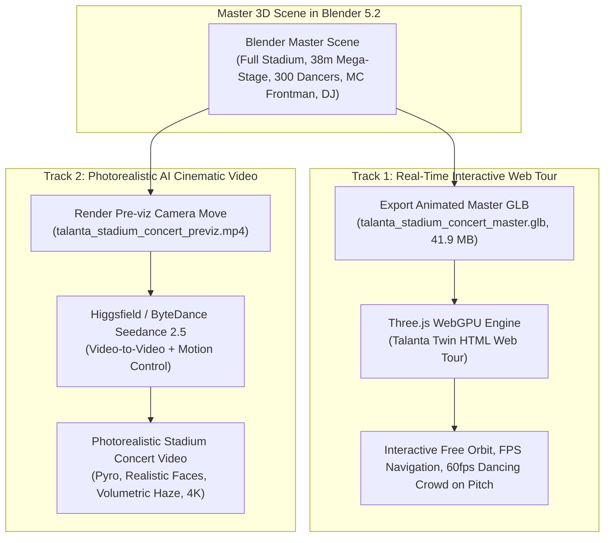

# Talanta Stadium Concert: Master 3D Digital Twin & Generative AI Video Pipeline

> [!IMPORTANT]
> **Visualization Notice (AGENTS.md Rule 7 & 8)**: Crowd placement and concert animations are illustrative visualizations for the Talanta Twin digital twin experience and cinematic pre-viz. No security-sensitive venue access points, CCTV layouts, or control facilities are depicted.

---

## 1. Architectural Clarity: Blender $\to$ Three.js vs. Blender $\to$ Higgsfield

A critical question arose during design:
> *"What is Higgsfield doing? Is it creating the video? Will it be created and then exported to Blender, or how does that work? ... for the HTML tour we want to see them there also."*

To understand how high-end creative studios combine Blender, Claude, and Generative Video AI, the workflow splits into **two complementary production tracks**:



### Why AI Video CANNOT be Imported Back as a 3D Mesh
* Generative video models (Higgsfield, ByteDance Seedance 2.5, Runway Gen-3, Kling AI, Sora) output **2D pixel grids (`.mp4` / `.mov`)**. They do not output polygonal vertices, skeletons, or materials.
* You cannot import a video file into Blender or Three.js and expect an interactive 3D model that you can orbit around or view from behind.
* **Therefore**:
  1. For the **Three.js Web Tour**: The interactive 3D stadium and avatars run natively in WebGL/WebGPU via **`talanta_stadium_concert_master.glb`**.
  2. For the **Cinematic Promotional Video**: Blender provides the deterministic camera trajectory, timing, and actor motion (pre-viz), which Higgsfield or Seedance then transforms into a hyper-realistic live-action concert film.

---

## 2. Competitive AI Video Platforms: Credits, Pricing & Student Access

| Platform | Free Tier / Daily Credits | Student Program | Video-to-Video (V2V) / Motion Control Capability | Best Use Case |
| :--- | :--- | :--- | :--- | :--- |
| **ByteDance Dreamina / Seedance 2.5** | **~120 daily credits free** (refreshes every 24 hours in CapCut / Dreamina). | Free daily replenishment acts as an ongoing student tier. | Outstanding multi-modal reference (up to 50 inputs), 30s coherent generations, realistic crowd physics. | **Best Free Option** for rendering Blender concert pre-viz into photorealism. |
| **Kling AI (v1.5 / v2.0)** | Free daily login bonus credits (~66 daily credits), watermarked on free tier. | None direct. | Class-leading human anatomy & limb dance physics, high temporal consistency. | Complex fluid dance moves (Samba / Hip Hop). |
| **Runway (Gen-3 Alpha / Turbo)** | 125 one-time starter credits on registration. | **25% Student Discount** via SheerID academic verification. | World-standard Camera Motion Control & Video-to-Video structure guidance. | Film-grade cinematic stadium lighting & lens flare. |
| **Higgsfield AI** | Free plan ($0): Basic model access (*Nano Banana Pro*), watermarked, **0 monthly generation credits** for heavy video. Short trial passes occasionally offered (~$3). Starter plan ~$19/mo. | No direct student discount. | High motion fidelity, character face-consistency (*Soul ID*). | Iterating character closeups from Blender proxy. |
| **Luma Dream Machine** | Free "Draft Mode" credits upon sign-up (watermarked, lower priority queue). | No dedicated student plan. | Fast camera trajectory adherence. | Rapid camera move testing. |
| **Meshy 3D** | ~200 free credits on sign-up, daily free tasks for text/image-to-3D. | Educational partnerships upon request. | Generates static/textured 3D meshes for Blender import. | Prop assets (DJ consoles, speakers, instruments). |

---

## 3. The Production Prompt for Higgsfield & ByteDance Seedance 2.5

Upload the pre-viz video into the Video-to-Video (V2V) / Motion Control tab:

### Master Prompt
```text
Massive live stadium concert at night inside Raila Odinga Talanta Stadium Nairobi, 60000 capacity arena, packed golden circle crowd of thousands dancing with hands in the air, ecstatic energy, lead artist frontman on catwalk thrust holding a microphone and raising arm hyping the stadium, elevated DJ performing behind illuminated console on main stage, massive 38-meter stadium festival stage, ultra-bright 4k LED stadium backwalls displaying vibrant neon purple and cyan visualizer waves, hanging side IMAG screens, sweeping stadium concert floodlights and cyan laser beams slicing into the night sky, sharp lens flares, photorealistic skin textures, sweat glistening under stage lights, authentic festival streetwear and colorful outfits, cinematic crane camera pushing forward through the dancing audience, 8k resolution, photorealistic, broadcast stadium concert footage.
```

### Motion & Style Settings
* **Mode**: Video-to-Video (V2V) / Motion Transfer
* **Motion Strength / Fidelity**: `0.70`
* **Aspect Ratio**: `16:9` (1920x1080)
* **Framerate**: `24 fps`
* **Negative Prompt**:
  ```text
  lowres, blurry, mannequin, clay render, grey plastic, floating limbs, extra hands, missing fingers, deformed face, cartoon, 3d blocky primitives, bad anatomy, overexposed blown out white.
  ```

---

## 4. Master Technical Assets Delivered

1. **`talanta_stadium_concert_master.blend`** (`E:\M5\grao\blender\out\talanta_stadium_concert_master.blend`, ~42 MB)
   - Master Blender 5.2 production file.
   - Complete Raila Odinga Talanta Stadium geometry (towering 60m canopy, roof ribs, ring beam, 3 grandstand seating tiers, and pitch perimeter).
   - $38\text{m} \times 16\text{m}$ mega-stage with $22\text{m}$ catwalk thrust and diamond performance T-stage.
   - Giant $36\text{m} \times 14\text{m}$ LED video wall and dual $9\text{m} \times 12\text{m}$ IMAG side video walls.
   - **MC Frontman Lead Artist**: Rigged Mixamo armature holding a 3D wireless microphone, with custom animation pumping their left arm rhythmically into the air to hype the stadium.
   - **Elevated DJ**: Positioned behind the CDJ console on the main stage riser.
   - **300 Mixamo Dancers**: Densely instanced across the Golden Circle, catwalk flanks, and pitch GA floor.
   - Lighting rig: 4 roof-mounted stadium floodlights, followspots on the lead artist, moving head beams, and 6 high-intensity concert lasers.
2. **`talanta_stadium_concert_master.glb`** (`E:\M5\grao\blender\out\talanta_stadium_concert_master.glb`, 41.9 MB)
   - Interactive 3D asset ready for Three.js WebGPU / WebGL digital twin (also copied to `app/public/data/talanta_stadium_concert_master.glb`).
3. **`talanta_stadium_concert_hero_shot.png`** (`C:\Users\hp\.gemini\antigravity\brain\2858ee5b-d6f7-4098-a001-26e528e5074c\talanta_stadium_concert_hero_shot.png`)
   - 1080p EEVEE beauty render showing the full stadium context, the mega-stage, illuminated catwalk frontman, and packed crowd.
4. **`talanta_stadium_concert_previz.mp4`** (`E:\M5\grao\blender\out\talanta_stadium_concert_previz.mp4`)
   - 120-frame 5-second 1080p camera crane pre-viz video.
