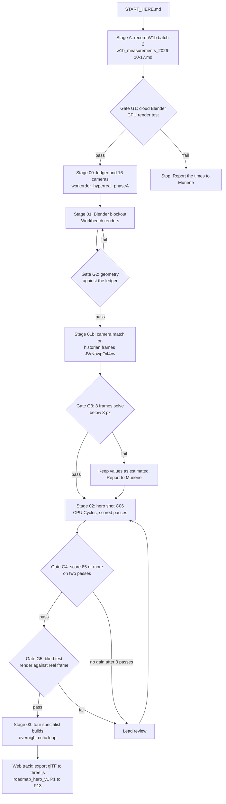

# START HERE: Talanta twin build runbook

Date: 2026-10-17
Branch: claude/hopeful-archimedes-lo15is
Owner: Munene (lead review in his local session)

This file is the single entry point for the cloud build chat. Munene pastes one line: "Read engineering/START_HERE.md on branch claude/hopeful-archimedes-lo15is and run it." Every other document is linked from here.

## How to work with Munene

- Pull the branch first: `git pull`. Read AGENTS.md, then this file, then the documents that the current stage names.
- Do the code, Blender and render work yourself in this cloud session. Munene's laptop is weak (Intel UHD 620, 7 GB RAM) and gets hot. Never ask him to build or render locally. No GPU is available, and he cannot rent one.
- Give Munene one step at a time, then wait for "done" or for the text that he pastes. Ask him only for things that need his PC: Google Earth Pro, a real-device browser check, a look at a render, and approvals.
- Before a long job, give the expected time. After each job, report the commits, pass or fail, and the next step.
- At each gate, stop and show the evidence. Munene takes renders to his lead session for review where this file says so.
- Update the "Status" table at the end of this file when a stage is complete, and commit it.
- Commit as Munene, with no Claude attribution. Push after each stage.

## Flow

## Stages and files

| Stage | What to do | Read these files | Munene's part | Gate |
|---|---|---|---|---|
| Done | Sol review fixes, five quick wins, roadmap | workorder_sol_review_2026-10-17.md, roadmap_hero_v1_2026-10-17.md | none | Done in commits 565e38b to 7be3c7e |
| A | Save W1b batch 2 as CSVs in gis/measurements/, update gis/site_measurements.md | w1b_measurements_2026-10-17.md | Draw the shapes that are still open (roof inner ring, bowl plinth, two training pitches). Export the "TALANTA w1b" folder as KML and paste it here | CSVs exist, and every value has a source and an image date |
| G1 | Prove that this cloud session can render. Run `blender -b --version`. Render the default scene, then a 200,000-triangle test scene, in CPU Cycles at 960 x 540, 64 samples, with the denoiser. Record the CPU count, RAM and the time for each frame | engineering/cloud_setup.sh | none | One look-check frame in 20 minutes or less |
| 00 | Parameter ledger and 16-camera manifest | workorder_hyperreal_phaseA_2026-10-17.md (Stage 00), review_astra_hyperreal_2026-10-17.md | none | Every number in bowl.js, site.js and pitch.js has a ledger row |
| 01 | Blender blockout from the ledger. Workbench renders C01 to C05. glTF round trip behind `?blender` | Phase A work order (Stage 01) | none | G2: geometry matches the ledger within its uncertainty |
| 01b | Camera match on historian frames. Measure heights and the roof, count ribs and bays, and write detail specs | Phase A work order (Stage 01b), research/frames/JWNowpO44rw/, research/video_index/MASTER_INDEX.csv, gis/heldout_frames.csv | none | G3: at least 3 frames solve below 3 px |
| 02 | Hero shot C06, golden hour, CPU Cycles, up to 3 scored passes | Phase A work order (Stage 02), research/concepts/2026-10-17/ (mood only) | Look at the C06 renders and take them to the lead session | G4: 85/100 on two consecutive passes. G5: blind test |
| 03 | Four specialist builds (roof and envelope, facade and bowl, landscape, people dressing) with an overnight critic loop | Astra review (pipeline stages 03 to 05) | Approve the start | Lead review of the critic scores |
| Web | Export the accepted Blender assets to three.js. Then run roadmap packages P0 to P13 | roadmap_hero_v1_2026-10-17.md | P0 device baseline. P5 measurements | The gates in the roadmap |

Hold roadmap package P1 (bowl.js polish) until gate G2 passes. After G2, the Blender blockout is the source of the bowl, and P1 work in bowl.js would be done twice. P0, P3, P5 and P7 can run at any time.

## Confidence gates

Confidence is not given in advance. Each gate turns a risk into evidence. Record each result in the Status table.

| Gate | Risk that it removes | Confidence after a pass (lead's estimate) | If it fails |
|---|---|---|---|
| G1 | The cloud cannot render, or is too slow | 70% to 75% | Render at lower resolution and use fewer cameras. Report to Munene before any other change |
| G2 | The geometry is wrong | 75% to 80% | Fix the ledger or the script, and repeat |
| G3 | The finished-state details are guesses | 80% to 85% | Keep those values "estimated". The look can still pass |
| G4 | The look does not reach the target | 90% | Lead review. Change the materials or the lighting, not the measurements |
| G5 | The result looks realistic only to us | 95% or more. After G5 the result is evidence, not a forecast | Lead review |

G5 blind test: show a C06-matched render and a real frame from the historian video at the same camera, side by side, without labels. Ask Munene and two other people which one is real, and to rate the realism from 1 to 5. G5 passes when the render scores 4 or more and the viewers cannot reliably pick the real frame. Keep this test internal (AGENTS.md rule 2).

## Overnight loop (stage 03 and later)

The reference project ran its critic loop overnight. Do the same after G5:

- Run the specialist builds in sequence, and render the 16 cameras in CPU Cycles at look-check settings.
- Score each pass with the eight Astra categories. Correct the two lowest categories.
- Stop at 85/100 on two consecutive passes, after 8 passes, or after three passes that gain less than 2 points.
- Commit after each pass, with the scores in blender/renders/pass_NN/scores.csv.

## Rules

- Follow AGENTS.md. Frames, Google Earth imagery and the concept renders are references only. Never use them as textures.
- Measured facts outrank looks. Label each value measured, derived or estimated, in the ledger and in the app.
- Keep gates, exits, camera positions and control rooms out of any public output.
- Label crowd views "Visualization" and rain "Simulation".

## Status

| Stage | Status | Evidence |
|---|---|---|
| Sol fixes and quick wins | Done | 565e38b to 7be3c7e |
| A | Done (2026-10-17) | Seven W1b CSVs in gis/measurements/ (roof outer and inner rings, bowl plinth, north plaza, warm-up track, training pitch SE, training field SW), each with source and image date 2025-12-26 (Airbus). Scale checks not possible: no pitch markings |
| G1 | Pass (2026-10-17) | Blender 5.2.2 (bpy wheel), 4 CPUs, 15.7 GB RAM. CPU Cycles 960x540, 64 samples, OIDN: default scene 7.1 s; 297,866-triangle scene 29.0 s. blender/renders/g1/g1_times.json |
| 00 | Not started | |
| 01 and G2 | Not started | |
| 01b and G3 | Not started | |
| 02, G4 and G5 | Not started | |
| 03 | Not started | |
