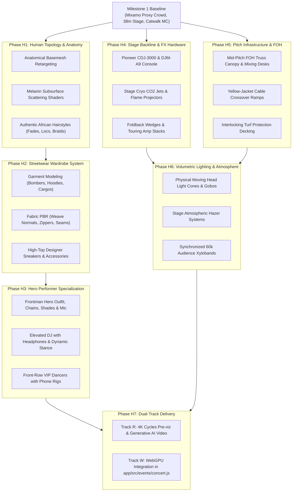

# Work order: production implementation of hyper-realistic concert digital twin

Date: 2026-11-16 (Africa/Nairobi)  
Project: Talanta Twin (`talanta-twin`), Raila Odinga Talanta Sports City Stadium, Nairobi  
Owner: Munene  
From: The Lead Engineering Session  
To: The Cloud Talanta Build Chat, Codex Workers, and 3D Asset Artists  
Status: Open. Master implementation specification from Mixamo milestone to photoreal final solution.  
Branch: `wo/web-hero-v2`  
Upstream Sources: `engineering/workorder_hyperreal_main_2026-11-10.md`, `engineering/completion_plan_2026-11-09.md`, `blender/CONCERT_PIPELINE.md`, `PLAN.md` (EVT-01, ENV-03, CAM-01), `AGENTS.md`.

Read `AGENTS.md` and `.claude/rules/commit-ownership.md` before starting.

---

## 1. Executive Context & Scope Definition

This work order governs the end-to-end technical execution required to advance the Talanta Stadium Concert digital twin from the current **Mixamo Mocap Milestone** (which established the spatial staging, 38m mega-stage, and 300 animated crowd avatars) to the **Final Photorealistic Solution**.

### 1.1 The Production Mandate
1. **From Stylized Proxies to Real-Life Humans**: The stylized, mannequin-like proxies must be replaced with fully realized, photorealistic African performers and audience members featuring anatomically accurate topologies, authentic melanin skin shaders with subsurface scattering (SSS), diverse hairstyles (fades, locs, braids, cornrows), and physical streetwear clothing.
2. **From Stage Blocking to Touring-Grade Production**: The stage and field must be upgraded with authentic touring backline gear (Pioneer CDJ-3000 / DJM-A9 setups, stage foldback wedges, cryo CO2 cannons, flame projectors, guitar amp stacks), a mid-pitch Front-of-House (FOH) production control booth, yellow-jacket cable ramps, and Mojo crowd barricades.
3. **Dual-Track Delivery**:
   * **Track R (Render/Video)**: Offline film-grade Cycles/EEVEE Next rendering (4K stills, volumetric haze, and camera crane pre-viz) engineered as deterministic structural guidance for ByteDance Seedance 2.5 and Higgsfield Video-to-Video generation.
   * **Track W (Web/Interactive)**: High-performance LOD-culled, instanced assets running at 60 fps in Three.js WebGPU inside `app/src/events/concert.js`.

---

## 2. Milestone 1 Baseline Audit (Where We Stand Today)

The foundation built on branch `wo/web-hero-v2` establishes the spatial anchor:

| Component | Current Asset / Implementation | Status |
| :--- | :--- | :--- |
| **Stadium Architecture** | `app/public/data/blockout.glb` (7.8 MB). 30-node hierarchy: 60m canopy roof, roof ribs, ring beam, 3 seating tiers, concourse, pitch at $Z = 6.20\text{m}$. | **Locked & Verified** |
| **Mega-Stage Geometry** | $38\text{m} \times 16\text{m}$ deck ($Z = 7.80\text{m}$), $22\text{m}$ catwalk thrust down pitch centerline, diamond performance T-stage ($8.5\text{m} \times 4.2\text{m}$). | **Locked & Verified** |
| **Audio-Visual Staging** | $36\text{m} \times 14\text{m}$ main LED backwall, dual $9\text{m} \times 12\text{m}$ IMAG screens, heavy-duty truss towers reaching 22m, J-hang line arrays, 4 roof floodlights, 6 lasers. | **Locked & Verified** |
| **Crowd Staging (Pitch)** | 300 Mixamo animated dancers instanced across Golden Circle, catwalk flanks, and GA floor. Zero proximity collisions (<0.7m) and zero structural overlaps verified via `blender/audit_crowd_placement.py`. | **Locked & Verified** |
| **Frontman MC** | Positioned at catwalk T-head $(0, 2.0, 7.50)$, holding 3D wireless microphone, animated with custom arm-pumping choreography hyping the 60,000-seat stadium. | **Locked & Verified** |
| **Master Production Files** | `blender/out/talanta_stadium_concert_master.blend` (~42 MB) and `app/public/data/talanta_stadium_concert_master.glb` (41.9 MB). | **Locked & Shipped** |

---

## 3. Work Breakdown: Phases from Mixamo Milestone to Final Solution



---

### Phase H1: Human Topology, Anatomy & Melanin Skin Shader Architecture

**Objective**: Replace stylized mannequin bodies with realistic human characters, optimized for both real-time WebGPU and offline Cycles rendering.

1. **Topology & Mesh Standard**:
   * Near/Hero tier: 8,000–15,000 triangles per character, quads-dominant, continuous edge loops around joints to prevent pinching under Mixamo mocap deformation.
   * Mid/Crowd tier: 1,800–3,500 triangles per character with baked normal maps from the high-poly sculpts.
   * Far tier (back pitch): 400–800 triangles billboarded/LOD-swapped.
2. **Melanin Subsurface Scattering (SSS) Shader System**:
   * Must use multi-layered melanin absorption formulas based on measured spectral reflectance of human skin.
   * Four production melanin tiers:
     * **Mahogany (Deep Rich)**: Base RGB `(0.18, 0.10, 0.05)`, Subsurface RGB `(0.40, 0.12, 0.04)`, Radius `[0.35, 0.15, 0.08]`, Roughness `0.42`.
     * **Chestnut (Warm Umber)**: Base RGB `(0.26, 0.15, 0.08)`, Subsurface RGB `(0.48, 0.18, 0.06)`, Radius `[0.38, 0.18, 0.10]`, Roughness `0.40`.
     * **Caramel (Golden Bronze)**: Base RGB `(0.38, 0.23, 0.14)`, Subsurface RGB `(0.55, 0.24, 0.10)`, Radius `[0.42, 0.22, 0.12]`, Roughness `0.38`.
     * **Bronze (Amber Tan)**: Base RGB `(0.48, 0.32, 0.20)`, Subsurface RGB `(0.62, 0.28, 0.14)`, Radius `[0.45, 0.25, 0.14]`, Roughness `0.38`.
   * Dual-specular lobe simulation: Micro-roughness specular coating to simulate natural skin hydration and sweat sheen under intense stage lighting.
3. **Facial Features & Hair Systems**:
   * Realistic African facial morphology (well-defined cheekbones, realistic lip volumes, and authentic eye geometry with corneal refraction).
   * 6 authentic hairstyle meshes:
     * High-top fade / buzz cut with scalp fade gradient.
     * Shoulder-length dreadlocks (rigged with soft-body bone chains for inertia).
     * Cornrows / geometric box braids.
     * Natural textured afro puff.
     * Short textured curls.
     * Braided top-knot fade.

**Deliverables & Files**:
* `blender/assets/characters/basemeshes/` (rigged FBX/blend files).
* `blender/materials/skin_melanin_pbr.py` (shader library).
* Quality Gate: 0 visible seams between neck and torso under moving spot beams.

---

### Phase H2: Streetwear Wardrobe & Cloth Dynamics Pipeline

**Objective**: Model, texture, and bind realistic concert streetwear clothing to the crowd archetypes.

1. **Garment Library**:
   * **Tops**:
     * Oversized streetwear drop-shoulder hoodies with kangaroo pockets and physical hood geometry.
     * Varsity / bomber jackets with ribbed knit collars, cuffs, and brass/chrome snap buttons.
     * Distressed denim jackets with chest flap pockets and contrast stitching.
     * Fitted graphic concert tour tees featuring fictional "Talanta Live 2026" tour typography.
     * Technical utility vests with 3D pockets and nylon straps.
   * **Bottoms**:
     * Multi-pocket cargo joggers with toggle hems and physical pocket flaps.
     * Relaxed-fit raw denim jeans with realistic knee fading and whiskering normals.
     * Track pants with side stripe piping and zippered ankles.
   * **Footwear**:
     * Chunky high-top basketball sneakers with detailed outsole grip patterns and colored collar accents.
     * Low-profile retro skate shoes with white rubber soles.
2. **PBR Fabric Materials**:
   * Procedural or 2K tiled fabric weave normal maps (twill, denim, fleece, French terry).
   * Cloth sheen / fuzz calculation via Principled BSDF Sheen parameters.
   * Seam stitching normal decals and physical metal zipper pulls.
3. **Accessories**:
   * Gold and silver Cuban-link chains (instanced curve meshes parented to clavicle/spine bones).
   * Futuristic festival visor shades and retro rectangular acetate sunglasses.
   * Concert VIP wristbands with micro-cloth texture.

**Deliverables & Files**:
* `blender/assets/clothing/` (outfit meshes parented to Mixamo armatures).
* `blender/materials/streetwear_fabrics.py`.
* Quality Gate: No mesh penetration between legs and pants during extreme dance poses.

---

### Phase H3: Hero Performer & Stage VIP Specialization

**Objective**: Give the Frontman, DJ, and VIP front row distinct visual weight and personality.

1. **Hero Frontman (Lead Artist)**:
   * **Wardrobe**: Custom designer iridescent varsity jacket with reflective chrome sleeve accents, leather cargo pants, and high-top sneakers.
   * **Accessories**: Thick gold Cuban-link chain with an African continent medallion, dark shield sunglasses with stage light reflection.
   * **Props**: Custom Shure Axient-style wireless handheld microphone (matte black body, metallic silver mesh dome, blue status LED display).
   * **Choreography**: Refined arm-pumping animation layered with natural head tilt, body lean, and left-hand microphone manipulation.
2. **Elevated DJ**:
   * Positioned on the center-stage DJ riser at $Z = 8.60\text{m}$.
   * Dressed in a relaxed streetwear hoodie and fitted cap.
   * Professional DJ over-ear headphones worn around the neck or angled over one ear.
   * Performance loop: Right hand on mixer EQ/filter, left hand cueing track on CDJ platter, rhythmic head bob.
3. **Hero VIP Audience Dancers**:
   * 12 detailed front-row avatars flanking the catwalk T-head.
   * 3D smartphones held aloft with glowing OLED screens facing back and camera flash LEDs illuminating the stage.

**Deliverables & Files**:
* `blender/build_concert_hero_frontman.py`.
* Quality Gate: Frontman visually dominates wide and telephoto camera frames from all stadium tiers.

---

### Phase H4: Touring Stage Backline & Special Effects Hardware

**Objective**: Model authentic, production-grade touring gear to transform the stage deck from an abstract blockout into an authentic concert platform.

1. **Pioneer DJ Touring Rig**:
   * **CDJ-3000 Multi-Players (Twin Units)**:
     * Dimensions: $329\text{mm} \times 453\text{mm} \times 118\text{mm}$.
     * 9-inch high-resolution touchscreen displaying emissive scrolling audio waveforms.
     * 206mm jog-wheel with central LCD display ring and LED position marker.
     * Hot Cue buttons, tempo slider with glowing zero LED, and tactile play/pause buttons.
   * **DJM-A9 4-Channel Professional Club Mixer**:
     * Dimensions: $407\text{mm} \times 458\text{mm} \times 107\text{mm}$.
     * 4 channel fader strips with 12-segment multi-color LED peak level meters.
     * 3-band EQ knobs, Sound Color FX dials, and Magvel Fader crossfader.
     * Beat FX OLED screen and illuminated channel cue buttons.
   * **Console Stand & Laptop**: Heavy-duty aluminum DJ console stand with open MacBook running DJ waveform visualizer.
2. **Stage Cryo & Special FX Hardware**:
   * **Cryo CO2 Jet Cannons (MagicFX / Le Maitre)**:
     * 8 units installed along the front lip of the catwalk and stage wings.
     * Steel floor mounting plate, high-pressure quick-connect hose, and dual angled stainless steel discharge nozzles.
     * Plume simulation: Inverted conical particle volumes with high forward velocity and rapid alpha dissipation.
   * **Stage Flame Projectors (Stage Flame Units)**:
     * 4 corner-mounted flame heads with hazard yellow warning graphics, ignition spark tips, and emergency shut-off valves.
3. **Stage Audio & Backline Monitoring**:
   * **Foldback Stage Wedge Monitors (d&b audiotechnik M4 style)**:
     * 10 low-profile monitors angled at 35° towards performers along the stage and catwalk edges.
     * Hexagonal metal grille texture, carry handles, and Speakon connector dish.
   * **Touring Amplifier Stacks (Stage Wings)**:
     * Twin Marshall 4x12 angled guitar cabinet stacks with black tolex, white piping, and gold logo script.
     * Ampeg SVT-810 bass refrigerator cabinet.
     * Dual-tier keyboard stand with 88-key weighted stage piano (Nord Stage 3 style).

**Deliverables & Files**:
* `blender/build_concert_backline_props.py`.
* `app/public/concert/props/` (modular GLB prop library).
* Quality Gate: Mesh polycount under 35,000 triangles total for all stage backline props combined.

---

### Phase H5: Front-of-House (FOH) Production Booth & Pitch Infrastructure

**Objective**: Add realistic production engineering infrastructure across the stadium pitch.

1. **Front-of-House (FOH) Sound & Lighting Booth**:
   * Positioned on the pitch centerline at $Y = -25.0\text{m}$, 35 meters downstage from the catwalk T-head.
   * Dimensions: $6.0\text{m}$ wide $\times 4.0\text{m}$ deep $\times 3.2\text{m}$ high.
   * Aluminum 4-post box-truss canopy with weatherproof black tarp roof.
   * Consoles:
     * DiGiCo SD7 / Quantum 338 digital audio mixing console with illuminated multi-screen fader banks.
     * GrandMA3 full-size lighting control console with 3 motorized touchscreens.
   * Seated sound engineer and lighting designer figures.
2. **Pitch Cable Infrastructure**:
   * Heavy-duty 5-channel yellow-jacket polyurethane cable protector ramps running from the stage underdeck to FOH.
   * High-contrast black and yellow warning stripes.
3. **Ground Protection Decking**:
   * Interlocking heavy-duty pitch protection floor panels (Terraplas / ArmorDeck standard) covering an $80\text{m} \times 90\text{m}$ pitch area.
   * Normal map depicting physical expansion seams and anti-slip diamond tread patterns.
4. **Mojo Crowd Safety Barricades**:
   * High-tensile aluminum barrier sections (1.2m high) enclosing the stage perimeter, catwalk flanks, and dividing Golden Circle VIP from General Admission.
   * Integrated footplates and rear security step treads.

**Deliverables & Files**:
* `blender/build_concert_foh_and_infrastructure.py`.
* Quality Gate: Cable bridges and barricades correctly align with pitch decking without vertical clipping.

---

### Phase H6: Volumetric Lighting, Lasers & Atmospheric Simulation

**Objective**: Recreate the cinematic atmosphere of a 60,000-seat night stadium show.

1. **Physical Moving Head Light Cones**:
   * 24 automated profile/beam fixtures mounted across top and mid stage trusses.
   * Volumetric absorption and scattering density using Blender Cycles principled volume ($0.015\text{ m}^{-1}$) and EEVEE Next raytraced light shafts.
   * Accurate cone angles ($3^\circ$ razor beams to $45^\circ$ stage washes) with rotating gobo textures.
2. **Aerial Concert Lasers**:
   * 6 high-output solid-state laser projectors (RGB 30W) mounted on top truss corners.
   * Razor-sharp emissive cylinder geometries cutting through the stadium roof canopy into the night sky.
3. **Stage Hazer Systems**:
   * Dual industrial stage hazers (MDG Atmosphere style) positioned under stage wings.
   * Volumetric density gradient: Denser around stage deck ($0.04\text{ m}^{-1}$), diffusing into the stadium bowl ($0.008\text{ m}^{-1}$).
4. **Audience Xyloband Ecosystem**:
   * 60,000 LED wristbands mapped across grandstand seats and pitch crowd.
   * Instanced point-light / emissive quad particles that pulse, wave, and shift color palettes in synchronization with the stage lighting cues.

**Deliverables & Files**:
* `blender/finalize_concert_lighting_and_renders.py`.
* Quality Gate: Volumetric light cones pass through roof lattice without rendering artifacts or noise fireflies.

---

### Phase H7: Dual-Track Delivery Pipeline

#### Track R: Photoreal Offline Film & Generative Video Pre-viz
1. **Camera Choreography**:
   * 120-frame to 720-frame camera crane sequences:
     * Shot 01: Sweeping stadium flyover crossing the 60m canopy down into the pitch.
     * Shot 02: Dynamic front-pit push-in past dancing crowds towards the illuminated Frontman.
     * Shot 03: Catwalk reverse shot from behind Frontman looking out at 60,000 pulsing Xylobands.
2. **Offline Cycles Rendering**:
   * Resolution: $3840 \times 2160$ (4K UHD) at 24 fps.
   * Engine: Blender Cycles on dual Nvidia T4 / RTX 4090 GPUs.
   * Samples: 64 samples + OpenImageDenoise (OIDN).
3. **Generative Video AI Pipeline**:
   * Export MP4 pre-viz sequence to ByteDance Seedance 2.5 and Higgsfield Video-to-Video (V2V).
   * Settings: Motion transfer fidelity `0.70`, framerate `24 fps`.
   * Prompt adherence to [CONCERT_PIPELINE.md](file:///E:/M5/grao/blender/CONCERT_PIPELINE.md) Section 3 master prompt.

#### Track W: Three.js WebGPU Digital Twin Integration
1. **Model Optimization**:
   * Master asset GLB compressed with Draco / Meshopt.
   * Hard budget: File size $\le 45\text{ MB}$, draw calls $\le 120$ via geometry instancing.
2. **Integration into `app/src/events/concert.js`**:
   * Replace legacy CC-BY placeholder stage models with the unified `talanta_stadium_concert_master.glb`.
   * Wire custom shader uniforms for the $36\text{m} \times 14\text{m}$ LED video wall and real-time audio visualizer waves.
3. **Interactive Camera Bookmarks**:
   * Add interactive view selector to UI:
     * `Frontman POV`: Looking from catwalk diamond across 60,000 cheering fans.
     * `Golden Circle VIP`: Front-row perspective looking up at performer with lasers overhead.
     * `FOH Soundboard`: Wide panoramic view of the entire 38m stage and stadium canopy.
     * `Skybox Tier 2`: High VIP vantage point.

---

## 4. Phase Execution Roadmap & Quality Gates

| Gate | Milestone | Acceptance Criteria | Owner |
| :---: | :--- | :--- | :--- |
| **G1** | Human Topology & Skin | Melanin SSS shader matches real African skin tones under spot lighting; 0 neck/joint seams. | 3D Character Artist |
| **G2** | Streetwear & Wardrobe | 6 distinct outfits bound to Mixamo mocap; 0 mesh clipping during dance animations. | 3D Character Artist |
| **G3** | Backline Props | CDJ-3000, DJM-A9, Cryo jets, flame units, and wedges modeled and placed; <35k tris total. | 3D Asset Artist |
| **G4** | FOH & Infrastructure | Mid-pitch FOH booth, cable ramps, and Mojo barricades placed with zero terrain clipping. | Venue Layout Artist |
| **G5** | Lighting & Volumetrics | Moving head beams, stage lasers, and 60k audience Xylobands synchronized to cues. | Lighting TD |
| **G6** | WebGPU Performance | Master GLB loads in `app/src/events/concert.js` at 60 fps on mid-tier GPU; file $\le 45\text{ MB}$. | WebGPU Engineer |
| **G7** | Cycles & AI Video | 4K Cycles beauty pass rendered; Seedance 2.5 V2V video generated and verified. | Cinematic Lead |

---

## 5. Software Evidence & Verification Commands

All phases must be executed and audited via reproducible scripts:

```powershell
# 1. Audit crowd and prop placements for zero collisions (< 0.70m)
& "D:\Blender\blender-5.2.2-windows-x64\blender.exe" -b "blender/out/talanta_stadium_concert_master.blend" -P "blender/audit_crowd_placement.py"

# 2. Run test beauty render in EEVEE Next
& "D:\Blender\blender-5.2.2-windows-x64\blender.exe" -b "blender/out/talanta_stadium_concert_master.blend" -P "blender/finalize_concert_lighting_and_renders.py"

# 3. Export optimized WebGPU GLB
& "D:\Blender\blender-5.2.2-windows-x64\blender.exe" -b "blender/out/talanta_stadium_concert_master.blend" --python-expr "
import bpy
bpy.ops.export_scene.gltf(
    filepath='app/public/data/talanta_stadium_concert_master.glb',
    export_format='GLB',
    use_selection=False,
    export_animations=True,
    export_skins=True,
    export_morph=True,
    export_lights=True
)
print('Export complete.')
"

# 4. Verify WebGPU runtime in browser
npm run dev
```

---

## 6. Document Sign-Off & Indexing

This work order is recorded as part of the official engineering record for the Talanta Twin digital twin:
* Indexed in `README.md` under Section 1 (Current Demo Steps).
* Indexed in `blender/CONCERT_PIPELINE.md` as the master execution specification.
* Indexed in `blender/STATUS.md` as the active production order.
